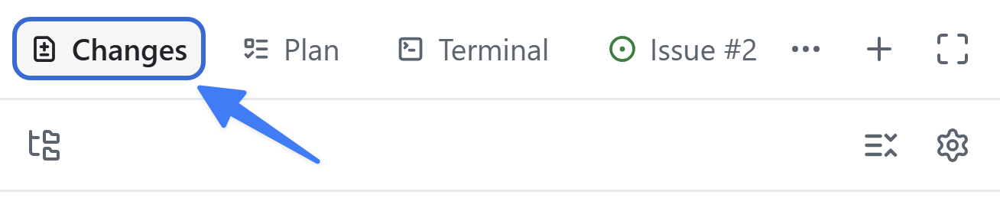

El contexto es clave cuando se trabaja con IA generativa. Si una tarea debe realizarse de una forma concreta, conviene proporcionar esa orientación a Copilot. Los [archivos de instrucciones][instruction-files] describen no solo *qué* código quieres, sino también *cómo* debe estructurarse. Ahora que has implementado el filtrado, explorarás las instrucciones que ha seguido Copilot, añadirás un estándar de documentación y lo aplicarás al código.

En esta lección:

- explorarás cómo llegan al agente las instrucciones del repositorio y las instrucciones específicas de rutas.
- actualizarás el archivo de instrucciones para garantizar que se sigan los estándares de programación.
- observarás el efecto de los archivos de instrucciones en el código.

## Escenario

Como cualquier buen equipo de desarrollo, Tailspin Toys tiene directrices y requisitos para las prácticas de desarrollo. Entre ellos:

- Los comentarios deben explicar la intención y las decisiones que no sean obvias, en vez de repetir el código.
- Las funciones exportadas de `db/` y `src/lib/` deben documentar su propósito, parámetros y valores devueltos mediante TSDoc/JSDoc, incluido el argumento `db` inyectable cuando exista.
- Los componentes reutilizables de Astro deben documentar sus contratos `Props`, y los comentarios deben mantenerse actualizados cuando cambie el código relacionado.
- Se deben conservar las directrices de formato y lint existentes.

Con los archivos de instrucciones, te asegurarás de que Copilot tenga la información necesaria para realizar las tareas de acuerdo con estas prácticas.

## Archivos de instrucciones

Las instrucciones personalizadas proporcionan contexto y preferencias a Copilot para que entienda mejor tu estilo y tus requisitos de programación. Te permiten especificar convenciones, bibliotecas e incluso los tipos de comentarios que prefieres. Puedes crear instrucciones para todo el repositorio o para tipos concretos de archivos y tareas.

Hay dos tipos de archivos de instrucciones:

- `.github/copilot-instructions.md`: un único archivo que se envía a Copilot en **todas** las solicitudes del repositorio. Debe contener información del proyecto pertinente para la mayoría de las solicitudes, como la pila tecnológica, una descripción general de lo que se está creando, las prácticas recomendadas y otras directrices generales.
- `.github/instructions/*.instructions.md`: archivos con directrices para lenguajes, tipos de archivos o tareas concretos.

> [!NOTE]
> La disponibilidad de otros formatos de instrucciones varía según el entorno. Consulta la [referencia de compatibilidad con instrucciones personalizadas][custom-instructions-support] antes de depender de un formato concreto.

## Explora los archivos de instrucciones personalizadas de este proyecto

El proyecto inicial ya incluye varios archivos de instrucciones. Explóralos antes de hacer cambios para observar el efecto que tienen.

1. Vuelve a la sesión de la lección anterior.
2. Si el panel de revisión aún no está visible, selecciona **Toggle review panel** en la esquina superior derecha para abrirlo.

   

3. Selecciona el icono **+** para abrir un lienzo nuevo en el panel.
4. Selecciona **Files**.
5. Selecciona el icono **Gear** y comprueba que **Show hidden files** esté marcado.
6. Ve a `.github/copilot-instructions.md`.
7. Explora el archivo y fíjate en la breve descripción del proyecto y las secciones **Agent notes**, **Code standards**, **Scripts** y **Repository Structure**. En **Code standards**, fíjate también en las directrices anidadas de **GitHub Actions Workflows**. Se aplican a cualquier interacción con Copilot.
8. Ve a la carpeta `.github/instructions` y explora los archivos. Hay instrucciones para archivos Astro, la capa de datos de Drizzle, las pruebas y otros elementos.
9. Abre `.github/instructions/unit-tests.instructions.md`. Fíjate en el campo `applyTo` de la parte superior: define un patrón glob relativo a la raíz del repositorio que determina a qué archivos se aplican las instrucciones. En este caso, se aplican a los archivos de pruebas TypeScript, como los que coinciden con `**/*.test.ts`.
10. Lee las instrucciones específicas para crear pruebas unitarias en este proyecto.
11. Por último, abre `.github/instructions/drizzle.instructions.md` y desplázate hasta el final. Fíjate en los enlaces a otros archivos de instrucciones, como `unit-tests.instructions.md`, y a archivos existentes del proyecto. Así puedes dividir conjuntos extensos de instrucciones en archivos más pequeños y reutilizables, y señalar a Copilot ejemplos que debe seguir. Las rutas son relativas al archivo de instrucciones, no a la raíz del repositorio.

## Actualiza los archivos de instrucciones para reflejar las directrices del equipo

Los archivos existentes son un buen punto de partida, pero falta una directriz. Modifica el archivo principal `copilot-instructions.md` para indicar que el código TypeScript generado debe incluir comentarios TSDoc.

> [!NOTE]
> Los archivos de instrucciones influyen mucho en el código que genera Copilot, así que debes asegurarte de que lo orienten con claridad. Puedes pedir a Copilot que cree una primera versión y, después, revisarla para comprobar que las actualizaciones cumplen los requisitos. También puedes consultar una [colección de archivos de instrucciones en Awesome Copilot][awesome-copilot] como punto de partida.

1. En el mismo lienzo **Files**, ve a `.github/copilot-instructions.md`.
2. Cambia a la vista de origen editable seleccionando el botón de código (el icono `<>`) de la barra de herramientas del archivo.
3. Busca el encabezado **Code formatting requirements**, que debería estar aproximadamente a mitad del archivo.
4. Añade este texto como último elemento de la lista debajo del encabezado:

   ```plaintext
   Todo el código TypeScript nuevo debe incluir comentarios TSDoc con fines de documentación.
   ```

El archivo se guarda automáticamente y ya está listo para usarse.

## Usa las instrucciones actualizadas

Una vez actualizado el archivo de instrucciones, pide a Copilot que revise los cambios y modifique el código para observar el efecto en el código generado.

> [!NOTE]
> Indicaremos explícitamente a Copilot que utilice el archivo de instrucciones porque acabamos de modificarlo. Cuando generes código con archivos de instrucciones ya existentes, Copilot los utilizará automáticamente sin que tengas que indicárselo.

1. Pide a Copilot que utilice los archivos de instrucciones para adaptar el código a los nuevos requisitos:

   ```plaintext
   Acabamos de actualizar nuestras instrucciones y directrices de código. ¿Puedes actualizar el código que generaste para que las cumpla?
   ```

2. Selecciona **Changes** en la esquina superior derecha para abrir los cambios de código.

   

3. Revisa los archivos TypeScript. Observa los comentarios TSDoc recién generados.

## Resumen y siguientes pasos

Has explorado cómo la aplicación obtiene contexto de los archivos de instrucciones y has aplicado un estándar nuevo a la característica. En concreto:

- has explorado el archivo `copilot-instructions.md` del repositorio y los archivos `*.instructions.md` específicos de rutas.
- has actualizado el archivo de instrucciones para garantizar que se sigan los estándares de programación.
- has observado el efecto de los archivos de instrucciones en el código generado.

A continuación, [personalizarás y ejecutarás la aptitud reutilizable `quality-checks`][next-lesson] para garantizar que las pruebas y el lint se ejecuten de forma coherente.

## Recursos

- [Archivos de instrucciones para personalizar GitHub Copilot][instruction-files]
- [Personalizar la aplicación GitHub Copilot][customize-app]
- [Prácticas recomendadas para crear instrucciones personalizadas][instructions-best-practices]
- [Awesome Copilot: colección de archivos de instrucciones y otros recursos][awesome-copilot]

[next-lesson]: ../5-agent-skills/
[instruction-files]: https://docs.github.com/copilot/customizing-copilot/about-customizing-github-copilot-chat-responses
[customize-app]: https://docs.github.com/copilot/how-tos/github-copilot-app/customize-github-copilot-app
[instructions-best-practices]: https://docs.github.com/copilot/concepts/prompting/response-customization#writing-effective-custom-instructions
[awesome-copilot]: https://awesome-copilot.github.com/
[custom-instructions-support]: https://docs.github.com/copilot/reference/custom-instructions-support
[tsdoc]: https://tsdoc.org/
[ui-instructions]: https://github.com/github-samples/tailspin-toys/blob/main/.github/instructions/ui.instructions.md
[astro-instructions]: https://github.com/github-samples/tailspin-toys/blob/main/.github/instructions/astro.instructions.md
[managing-issues-prs]: https://docs.github.com/copilot/how-tos/github-copilot-app/managing-issues-and-pull-requests
